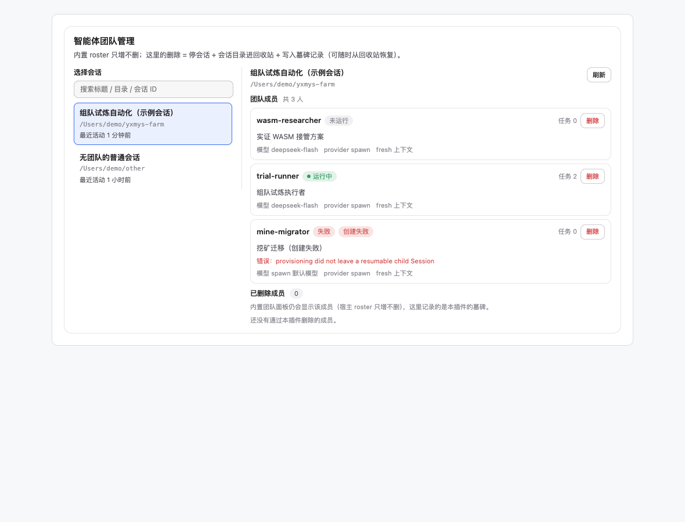

# dsh-team-admin

给 DeepSeek Harness 的「智能体团队（Agent Teams）」补一个**管理面**：在 GUI 里选任意会话，查看它的团队成员，**删除角色并清理该成员的持久会话**。

## 为什么需要

v0.2.x 的内置 Team roster 是 **append-only**：只能 `spawn_teammate` 加人，没有删除 / 改名 / 名字复用（见 `dsh-experimental-agent-team` 的 Known Limitations）。成员上下文耗尽、任务结束或建错时，只能"停手不理会"，名单和名额永久占着。

本插件补上缺失的那一半：

- 列出任意根会话的团队成员（名字、状态、描述、模型、名下任务数）
- 删除成员：中断运行中的会话 → 成员会话目录**移入回收站** → 写墓碑，管理面标记「已删除」
- 已删除成员集中展示，回收站路径可复制

## 安装

```sh
dsh plugin --profile web add @chenkai114/dsh-team-admin
```

重启 / 重载后，打开 **设置 → 插件 → dsh-team-admin**（或插件管理页里本包的配置卡），即可看到「智能体团队管理」面板。

未发布前用本地源码链接安装：

```sh
dsh plugin --profile web add link:/Users/chenkai2/data1/www/htdocs/dsh-team-admin
```

或在 profile 的 `package.json` 里手动加：
```json
{
  "dependencies": { "@chenkai114/dsh-team-admin": "link:/Users/chenkai2/data1/www/htdocs/dsh-team-admin" },
  "dsh": { "profile": { "bundles": ["...", "@chenkai114/dsh-team-admin"] } }
}
```



## 用法

1. 搜索并选中一个会话（只列根会话）
2. 面板显示该会话的团队成员
3. 点某个成员的「删除」→ 行内二次确认 → 确认
4. 成员会话进回收站，管理面把它移到「已删除」区

## 删除到底做了什么

| 步骤 | 行为 |
|---|---|
| 停止 | 运行中的成员会被中断，最多等 15s 变 inactive；超时则报错不动数据 |
| 清理会话 | 成员会话目录 `~/.dsh/sessions/.../<memberId>/` 移到 `~/.dsh/team-admin/trash/<leadSessionId>/<memberId>-<ms>/`（**移动，不是删除**，可手工恢复） |
| 墓碑 | 写入 `~/.dsh/team-admin/state.json`，管理面据此显示「已删除」 |

## 边界（重要）

- **内置团队面板仍会显示该成员**：宿主 roster 是 append-only，本插件不（也无法）从 Lead 会话日志里抹掉记录。管理面才是"已删除"的真源。
- **名额不返还**：内置 `maxMembers` 统计的是历史成员记录，删了也占位；新角色请用新名字（`spawn_teammate`）。真需要重置名额时，fork / 新开会话换一个 Team。
- **只删成员，不删 Lead**：`lead` 与任意根会话都不受影响。
- **仅本机**：所有接口只接受回环地址；删除动作不会暴露到网络。
- **不做的事**：不改内置团队工具的语义、不写 Lead 会话日志、不碰任务板（成员名下的任务仍留在任务板上，需要时用 `team_task_update` reassign）。

## 配置

| 变量 / 字段 | 默认 | 说明 |
|---|---|---|
| `DSH_TEAM_ADMIN_DATA_DIR` | `~/.dsh/team-admin` | 墓碑与回收站根目录 |

## 开发

```sh
npm test          # node:test，纯本地，不依赖运行中的 dsh
```

模块划分与 HTTP 契约见 [docs/CONTRACT.md](docs/CONTRACT.md)。

## 发布

仓库走 GitHub Actions + npm Trusted Publishing（OIDC），与 dsh-daemon 同构：

1. npm 包页面 → Settings → Trusted Publisher → GitHub Actions，填 `chenkai2` / `dsh-team-admin` / `publish.yml` / `npm-publish`
2. 升 `package.json` 版本（同时改 `src/index.js` 的 `PLUGIN_VERSION`）→ 打 tag `vX.Y.Z` → 发 GitHub Release
3. Actions 自动校验 tag/版本、跑测试、`npm publish --provenance --access public`

## License

MIT